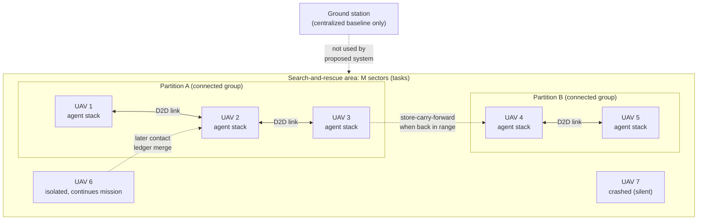
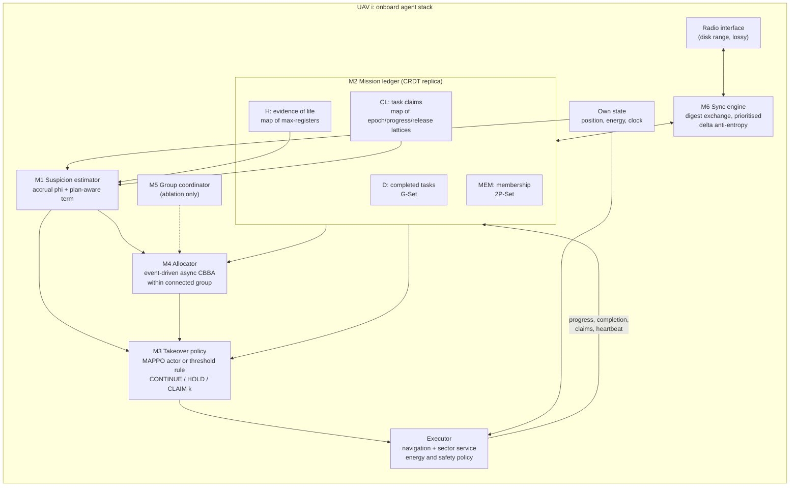
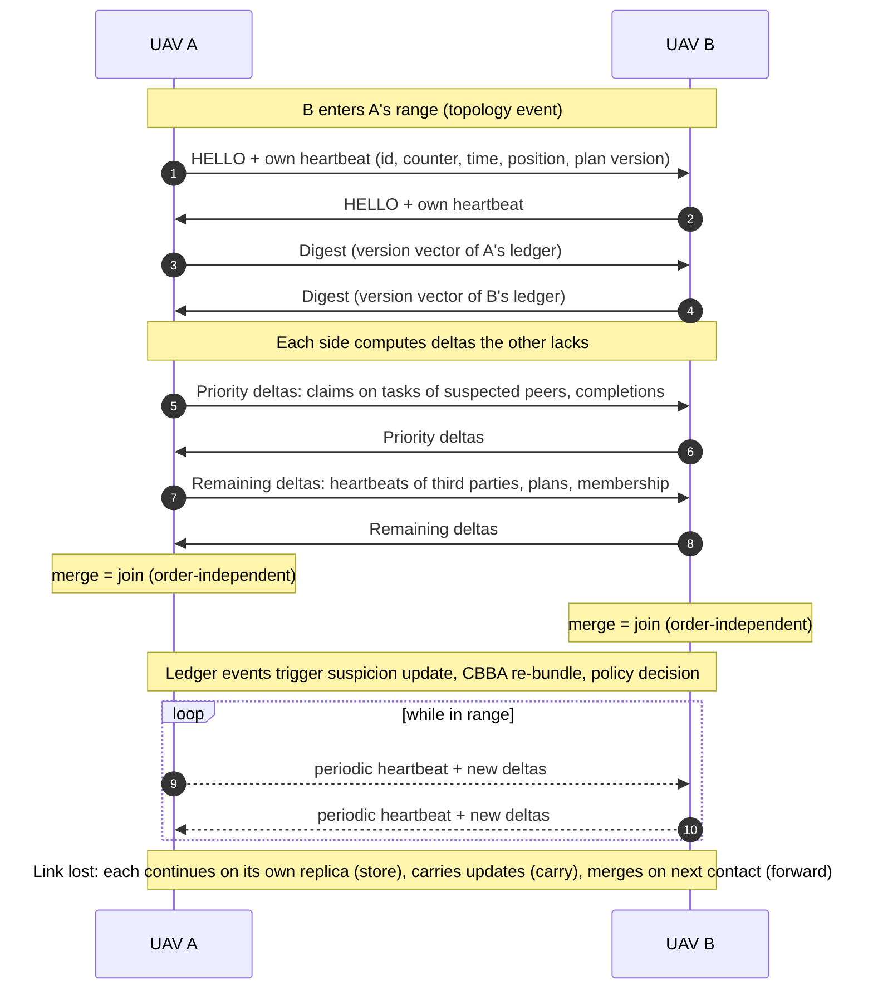
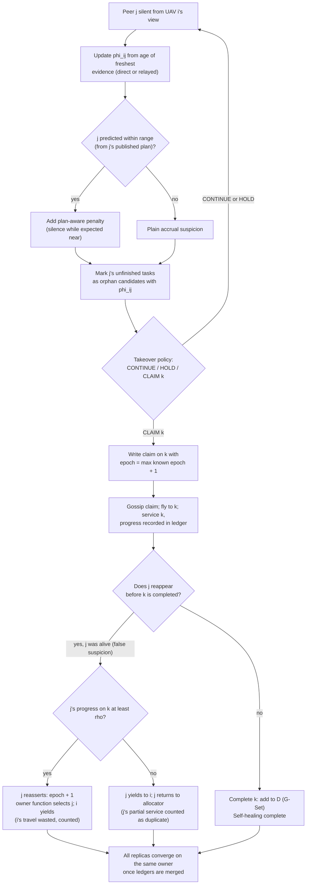
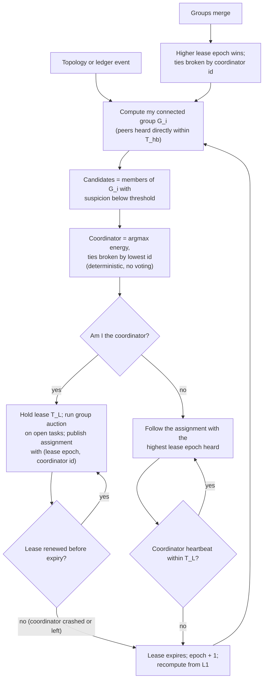

# Step 5: System Architecture, Mathematical Formulation and Implementation Methodology

**Project:** Self-Healing Task Allocation for Decentralized UAV Swarms under Intermittent Connectivity and Ambiguous Failures
**Date:** 2026-11-22
**Builds on:** Step 3 (scope), Step 4 (component selections). `[Rxx]` → `02_Step2_Literature/Reference_Verification_Table.csv`.

**Status of content:** everything here is a *proposed design*. Nothing has been implemented or tested yet. Claims marked **(to verify)** are hypotheses for the experiments in Steps 6–7.

---

## 1. Architecture overview

### 1.1 Design principles
1. **Every drone is self-sufficient.** It holds a full replica of the mission ledger and can plan, execute and finish tasks with no peer contact (master prompt §3A).
2. **Coordinate when possible, never depend on it.** Contacts improve the plan, but missing contacts never block progress (availability over consistency [R09]).
3. **Correctness lives in the data, not the network.** The mission state converges deterministically whatever the order of message delivery (CRDTs [R10, R11]). Learning only affects efficiency.
4. **Suspicion, not verdicts.** A silent peer is suspected to a degree. It is never declared dead (accrual detection [R07]).
5. **No permanent leader.** A per-group coordinator is optional and its role is derived from shared data, never elected by voting (ablation only).

### 1.2 Diagram 1: High-level architecture



Every UAV runs the same agent stack (Diagram 2). Groups (partitions) form and dissolve as drones move. The only inter-drone interface is ledger exchange on contact. UAV 6 (alive but isolated) and UAV 7 (crashed) look the same to everyone else. Telling them apart is the problem this research addresses.

### 1.3 Diagram 2: Per-UAV component architecture



**How the components interact:**

| From → To | What flows | When |
|---|---|---|
| Executor → Ledger | Own heartbeat (H), progress on the current task (CL), completion (D) | Every step / on events |
| Sync ↔ Ledger ↔ Radio | Digests and deltas; merged updates | On each new contact and periodically while in contact |
| Ledger + own state → Suspicion | Freshest evidence per peer; peers' published plans | Continuously |
| Ledger + Suspicion → Allocator | Open tasks (not complete, not owned by an unsuspected live peer); group membership | On topology or ledger events |
| Allocator + Suspicion + Ledger → Policy | Current bundle; candidate *orphan* tasks (owner suspected) | At decision epochs |
| Policy → Executor | Next action: continue bundle, hold, or claim orphan task k | At decision epochs |
| Coordinator → Allocator | Group-level assignment replacing CBBA | Ablation H4 only |

### 1.4 Diagram 3: Communication flow on contact



Steps 6–7 send the information most important for self-healing first, which matters for short contacts. Lost messages are harmless: the next digest exchange re-sends whatever is missing, and duplicates are absorbed because merge is idempotent.

### 1.5 Diagram 4: Failure-recovery workflow (self-healing)



The two error types from Step 3 are measured at S12/S13 (false suspicion: wasted or duplicate work) and as the delay before S7 when j really crashed (recovery time). The policy at S6 is what RQ1/RQ3 study.

### 1.6 Diagram 5: Group coordinator workflow (ablation H4)



Unlike Raft [R65], a minority group still gets a coordinator, so availability is kept. Two coordinators in different groups are expected; when the groups merge, the epoch rule resolves the conflict. The coordinator only *proposes* allocations. Ownership is still decided by the ledger's owner rule (§2.4), so the coordinator can never break ledger consistency.

### 1.7 Diagram 6: Example of a disconnected drone continuing its mission

```mermaid
sequenceDiagram
    autonumber
    participant U3 as UAV 3 (becomes isolated)
    participant U5 as UAV 5 (main group)
    participant SW as Rest of main group
    Note over U3,SW: t=0-100 s: all connected. U3 owns tasks k7, k8 (epoch 1)
    U3->>U5: heartbeat, plan [k7, k8]
    Note over U3: t=120 s: flies beyond R_c towards k7 (link lost)
    Note over U3: Isolation policy: keep own bundle, keep publishing heartbeats locally
    U3->>U3: service k7, record completion in own D
    Note over U5,SW: phi(U3) rises slowly: U3's plan predicts it is far away
    Note over U3: t=210 s: starts k8 (progress grows)
    Note over U5: t=240 s: phi(U3) high; policy chooses CLAIM k8 (epoch 2)
    U5->>SW: gossip claim (k8, U5, epoch 2)
    Note over U5: flies to k8
    Note over U3: t=280 s: k8 progress 0.75; flies back toward last known group position
    U3->>U5: t=300 s: contact. Digest + deltas: completion k7; claim (k8, U3, epoch 1, progress 0.75)
    Note over U3: progress 0.75 at least rho=0.5: reassert k8 with epoch 3
    U3->>U5: claim (k8, U3, epoch 3)
    Note over U3,U5: Owner(k8) = U3 on both replicas; U5 yields
    U5->>SW: gossip: completion k7, claim (k8, U3, epoch 3)
    Note over U5: U5's travel toward k8 counted as wasted distance
    Note over U3,SW: All replicas converge: k7 done, k8 owned by U3
```

**Isolation (safety) policy** for any drone with no contact:
1. Finish own bundle in order.
2. Then take the nearest task that is *open* in its own replica, claiming it with the usual epoch rule.
3. Every T_rv seconds, if energy allows, divert toward the last known position of the largest group (rendezvous attempt). Recommend T_rv = 120 s; tuned in a pilot.
4. If the remaining energy only covers the return trip plus a margin, abandon tasks and return to base. Claims are released with progress kept.

---

## 2. Mathematical formulation

### 2.1 System model

- **Drones** 𝒩 = {1,…,N}. Drone i has position **p**_i(t) ∈ ℝ², cruise speed v, energy e_i(t), and true status σ_i(t) ∈ {alive, crashed}. σ_i is known only to the simulator.
- **Tasks** 𝒦 = {1,…,M}. Each task k has a sector centre **q**_k, service time s_k > 0 and weight w_k > 0.
- **Time** t ∈ {0, Δt, 2Δt, …, T_max}.
- **Energy:** e_i(t+Δt) = e_i(t) − c_f·Δt·𝟙[moving or servicing] − c_m·n_i^tx(t), where n_i^tx(t) is the number of messages sent in the step.
- **Communication graph:** 𝒢(t) = (𝒩_alive(t), ℰ(t)), with (i,j) ∈ ℰ(t) ⇔ ‖**p**_i(t) − **p**_j(t)‖ ≤ R_c.
- **Delivery probability** over a link of length d:
  q(d) = q₀ · (1 − (d/R_c)^γ) for d ≤ R_c, and 0 otherwise.
  Optional Gilbert–Elliott mode: a two-state Markov chain (Good/Bad) per link with loss probabilities ℓ_G ≪ ℓ_B and transition probabilities p_GB, p_BG [R27].
- **Partitions:** the connected components 𝒞₁(t), …, 𝒞_c(t) of 𝒢(t).
- **Failure process:** a set of crash times {(i, t_i^crash)} drawn per seed. When drone i crashes, σ_i = crashed from that time on, and it stops moving and transmitting.

**Temporal connectivity assumption (A1).** For convergence results, the graphs over any window of length W, taken together, connect all alive drones; in other words, information can travel between any two alive drones within W. If A1 fails (groups never meet again), no protocol can reconcile them. CC-OPI notes the same limit [R66].

### 2.2 Mission ledger as a state-based CRDT

Each drone i holds a replica L_i = (D_i, H_i, CL_i, MEM_i). Every component is a **join-semilattice** (S, ⊔): a set with a merge ⊔ that is commutative, associative and idempotent. Every local update moves the state upward in the lattice (an *inflation*).

**(a) Completed tasks: G-Set.**
D_i ⊆ 𝒦 × 𝒩 × ℝ (task, completer, time).
Merge: D_i ⊔ D_j = D_i ∪ D_j.
Derived: done_i(k) = 1 ⇔ some record (k, ·, ·) ∈ D_i.

**(b) Evidence of life: map of single-writer max-registers.**
H_i : 𝒩 → (c, τ, **p**, π^plan), where c ∈ ℕ is the heartbeat counter, τ the time stamp, **p** the position and π^plan the published plan (task sequence and planned arrival times).
Only drone j increments c_j, and does so on every heartbeat. Merge per drone j: keep the entry with the larger c.
Because c_j has a single writer and only increases, each counter value has exactly one tuple, so the merge is well defined and is a join.

**(c) Task claims: map of product lattices.**
CL_i : 𝒦 × 𝒩 → (ε, ρ, r) ∈ ℕ × [0,1] × ℕ, with entry (k, j) written **only by drone j**:
- ε_kj: claim epoch;
- ρ_kj: progress fraction on task k (only increases);
- r_kj: release epoch (claim (k, j) is *active* ⇔ ε_kj > r_kj).

Merge per entry: component-wise maximum,
(ε, ρ, r) ⊔ (ε′, ρ′, r′) = (max(ε, ε′), max(ρ, ρ′), max(r, r′)).
Updates by drone j on task k:
- **Claim or takeover:** ε_kj ← 1 + max over all claimants ℓ of ε_kℓ (in j's replica).
- **Reassert:** identical to claim; allowed only when ρ_kj ≥ ρ̄ (the reassertion threshold).
- **Progress:** ρ_kj ← max(ρ_kj, new progress).
- **Release:** r_kj ← ε_kj.

Each update only increases the entry, so each is an inflation.

**(d) Membership: 2P-Set.** MEM_i = (A_i, R_i), merged by union of both sets. member_i(j) ⇔ j ∈ A_i and j ∉ R_i. Planned leave adds j to R. Crashes are **never** added to R.

**Proposition 1 (strong eventual consistency, to be formally proven in Step 7).**
The ledger is the product of join-semilattices (a)–(d), the merge is the component-wise join, and every local update is an inflation. Therefore any two replicas that have received the same set of updates are equal, whatever the delivery order, duplication or delay. This is the standard result for state-based CRDTs [R10]. Under assumption A1, every update reaches every alive drone within finite time, so all alive replicas converge.

### 2.3 Derived quantities (computed locally and deterministically)

- **Open task:** open_i(k) ⇔ done_i(k) = 0, and no *active* claim (k, j) exists whose claimant j is unsuspected (φ_ij < Φ_open).
- **Orphan candidate:** orphan_i(k) ⇔ done_i(k) = 0, the current owner o_i(k) is defined, and φ_{i,o_i(k)} ≥ Φ_open.
- **Owner rule (R-C):**
  o_i(k) = argmax over active claimants j of the pair (ε_kj, −j).
  That is: the active claim with the highest epoch wins, and a tie goes to the lowest drone id.

**Proposition 2 (owner agreement).** o_i(k) depends only on CL_i. So once two replicas are equal (Proposition 1), they agree on every task's owner. Disagreement can exist only while replicas differ, i.e., between contacts. The amount of duplicated work this causes is exactly what the experiments measure.

Note: suspicion φ is **not** part of the ledger. It is a local view and never merged. It affects only which actions a drone *takes*. It never affects the merge or the owner rule, which keeps Propositions 1–2 independent of how good the detector is.

### 2.4 Suspicion estimator

For drone i observing peer j at time t:

- **Freshest evidence time:** τ_ij(t) = the τ field of H_i(j), whether heard directly or via relay.
- **Silence:** g_ij(t) = t − τ_ij(t).
- **Base accrual suspicion** (adapted from [R07]):
  φ_ij(t) = −log₁₀(1 − F̂_j(g_ij(t))),
  where F̂_j is the estimated distribution (CDF) of evidence gaps for peer j. Estimator: a mix of a prior F₀ (fitted per communication setting during training) and peer j's observed gaps over a sliding window. Weight on the observed gaps: n/(n + n₀), where n is the number of observed gaps.
- **Plan-aware term.** From j's published plan, predict j's position **p̂**_j(t). Define the "expected near" indicator
  η_ij(t) = 𝟙[‖**p**_i(t) − **p̂**_j(t)‖ ≤ β·R_c], with β < 1 as a safety margin.
  The "missed while expected near" time m_ij(t) is the total time during the current silence when η_ij = 1.
- **Combined suspicion:**
  φ̃_ij(t) = φ_ij(t) + κ · m_ij(t) / T_hb,
  where T_hb is the heartbeat period, κ ≥ 0 and κ = 0 is the ablation.

**Interpretation:** a peer silent while it should be far away is probably disconnected, so suspicion grows slowly. A peer silent while it should be in range is probably crashed, so suspicion grows quickly. Whether this actually separates the two cases is hypothesis **H5 (new, to verify):** with κ > 0 the false-suspicion rate drops at equal detection delay.

**Threshold takeover rule (baseline for RQ3):** at each decision epoch, claim the nearest orphan k with φ̃_{i,o(k)} ≥ Φ, if the drone is idle or the orphan's weighted value beats its next bundle item. Sweeping Φ traces the threshold rule's Pareto front.

### 2.5 Base allocator: event-driven asynchronous CBBA

Each drone i keeps a bundle b_i (an ordered list of tasks) and a path π_i. Following CBBA [R02], the score of a path is
S_i(π_i) = Σ over tasks k in π_i of w_k · λ_d^(τ_ik(π_i)),
where τ_ik is the planned completion time of task k and λ_d ∈ (0,1) a time discount.
The marginal gain of inserting task k is c_ik = max over insertion positions of [S_i(π_i ⊕ k) − S_i(π_i)].
Bundle building and conflict resolution follow ACBBA [R03], **but only over tasks with open_i(k) = 1 and only with peers in the current group**.
Re-bundling is triggered by: a topology change, a completion, a new claim, or any open_i(k) flipping.
Allocator winners write their ledger claim with the same Claim update as takeovers (Algorithm 3), so the first assignment gets epoch 1. A drone that loses a task in CBBA releases its claim. CBBA outcomes and takeovers therefore share one ownership record.

### 2.6 Takeover policy as a Dec-POMDP (MAPPO)

**Model:** ⟨𝒩, 𝒮, {𝒜_i}, P, R, {Ω_i}, O, γ_d⟩.

- **State** s ∈ 𝒮: all positions, energies, true statuses, ledger replicas, link states. Fully seen only by the critic.
- **Observation** o_i ∈ Ω_i:
  - own features: **p**_i, e_i, current task, remaining bundle length;
  - top-K orphan candidates, as feature vectors (relative position, w_k, s_k, φ̃_{i,o(k)}, g_{i,o(k)}, owner's last progress ρ, number of active claimants, own claim epoch);
  - up to L neighbours (relative position, energy).
  Sets are encoded by attention pooling [R78], so the input size does not depend on N or M.
- **Actions** 𝒜_i = {CONTINUE, HOLD, CLAIM(1), …, CLAIM(K)}, with invalid options masked out.
- **Decision epochs:** event-triggered (any φ̃ crossing a level set, new orphans, task completion), with a fallback every Δ_dec = 5 s. Rewards between epochs are summed, giving a semi-Markov setup. MAGEC uses a similar multi-step treatment [R53].
- **Team reward per step:**
  r_t = Σ over tasks k newly completed at t of (w_k − λ · Dup_k) − λ · Σ over tasks k of post_k(t) − μ · Σ over drones i of Δe_i(t),
  where:
  - Dup_k is the total service time spent on task k, up to its completion, by drones other than the completer. It is charged **when k completes**, so it is known at that moment;
  - post_k(t) is service time spent at step t on a task that is already complete in ground truth (e.g., by a drone that has not yet heard of the completion). It is charged immediately.

  Both terms are computed by the simulator from ground truth and are causal: they never use future information.
- **Objective:** maximise the discounted return E[Σ_t γ_d^t r_t] with MAPPO's clipped surrogate objective [R62]: a shared actor π_θ(a_i | o_i) and a centralised value V_ψ(s).
- **Trade-off sweep:** λ ∈ {0, 0.25, 0.5, 1, 2, 4}. Each value gives one point on the learned policy's Pareto front (recovery time vs. duplicated work).

### 2.7 Pseudocode

**Algorithm 1: Per-UAV control loop (runs on every alive drone i, every Δt)**
```text
loop each step t:
    executor.advance()                          # move / service current task
    if servicing k: CL_i[k,i].ρ ← max(ρ, progress); if done: D_i ← D_i ∪ {(k,i,t)}
    if t mod T_hb == 0: H_i[i] ← (c_i+1, t, p_i, plan_i)
    for each neighbour j in range (new or periodic):
        SyncExchange(i, j)                       # Algorithm 2
    update φ̃_ij for all j ≠ i                    # §2.4
    if event(topology | ledger | φ̃ level crossed | idle):
        ACBBA_rebundle(open tasks, current group)  # §2.5
    if decision_epoch():
        a ← policy(o_i)                          # MAPPO actor or threshold rule
        if a == CLAIM(k): Claim(i, k)            # Algorithm 3
    apply isolation/safety policy if no contact for T_rv or energy low   # §1.7
```

**Algorithm 2: SyncExchange(i, j)**
```text
send HELLO(H_i[i]); receive HELLO(H_j[j])
send digest(L_i); receive digest(L_j)
Δ_prio ← deltas for orphan-related claims and completions missing at j
Δ_rest ← all other deltas missing at j
send Δ_prio, then Δ_rest  (subject to per-contact bandwidth cap; remainder deferred)
on receive Δ: L_i ← L_i ⊔ Δ      # component-wise join; idempotent, order-free
raise ledger events for any changed derived quantity (done, owner, open, orphan)
```

**Algorithm 3: Claim / Reassert(i, k)**
```text
ε* ← max_ℓ CL_i[k,ℓ].ε
CL_i[k,i].ε ← ε* + 1                 # inflation
if returning drone with ρ_ki ≥ ρ̄ and o_i(k) ≠ i: same update (reassertion)
if o_i(k) ≠ i after merge: release: CL_i[k,i].r ← CL_i[k,i].ε; return to allocator
```

---

## 3. Implementation methodology

### 3.1 Software stack (final)

| Layer | Tool | Notes |
|---|---|---|
| Simulator core | Python 3.11+, NumPy | Discrete-time, vectorised where possible |
| MARL environment API | PettingZoo (parallel API) | Standard interface; enables reuse of MAPPO code |
| Learning | PyTorch; MAPPO implementation adapted from the authors' public code [R62] or an equivalent maintained library | Pin versions; record in config |
| Experiment management | YAML configs, fixed seeds, results in CSV/Parquet | One config per scenario × method × seed |
| Testing | pytest + property-based tests (e.g., Hypothesis) | CRDT laws checked automatically |
| Analysis | pandas, SciPy (statistical tests), matplotlib | Scripts produce every table and figure |
| Optional | ns-3 | Channel-model cross-check for one scenario only |

**Module layout:**
```text
uavsim/
  world.py        # area, tasks, kinematics, energy, crash injection
  comms.py        # range graph, loss models (Bernoulli, Gilbert–Elliott), bandwidth cap
  ledger.py       # CRDT components, merge, derived quantities
  suspicion.py    # accrual phi, plan-aware term, threshold rule
  allocator.py    # async CBBA, centralized oracle, greedy, CC-OPI re-implementation
  coordinator.py  # lease-based group coordinator (ablation)
  agent.py        # per-UAV loop (Algorithm 1), isolation policy
  env_marl.py     # PettingZoo wrapper, observations, masks, rewards
  metrics.py      # ground-truth metrics (Step 6)
  scenarios/      # YAML scenario definitions
tests/            # unit + property tests
experiments/      # run scripts, analysis notebooks
```

### 3.2 Phased plan (mapped to master prompt §10)

| Phase | Master-prompt phase | Work | Exit criterion (verification) | Est. duration |
|---|---|---|---|---|
| **P1** | 1. Baseline swarm | world.py, simple comms (full connectivity), greedy and centralized oracle allocators, metrics skeleton | Oracle reaches 100% completion with no faults; metrics checked by hand on a 3-drone, 5-task case | 3 weeks |
| **P2** | 2. Decentralized intelligence | Async CBBA per drone; isolation policy; per-drone agent loop | CBBA gives conflict-free allocations under full connectivity (assertion in tests); completion within a few % of the oracle | 3 weeks |
| **P3** | 3. FANET communication | Range graph, loss models, bandwidth cap; ledger CRDT + sync engine | **Property tests:** merge is commutative, associative, idempotent; random-delivery tests always converge (Proposition 1) | 3 weeks |
| **P4** | 4. Intermittent connectivity | Natural and forced partitions; CC-OPI re-implementation | CC-OPI reproduces its reported ~0.80 completion in its own setting (±5 pp) [R66]; replicas converge after forced splits | 3 weeks |
| **P5** | 5. Self-healing | Crash injection; suspicion estimator; threshold takeover; owner rule R-C; coordinator (ablation); **MAPPO training** | Threshold sweep gives a monotone trade-off curve (sanity check for H2); MAPPO training curves converge on ≥ 3 seeds | 5 weeks |
| **P6** | 6. Dynamic scalability | Join/leave; N sweep {6…32}; MARL generalisation tests | Policy trained on N ≤ 16 runs without error at N = 32; join merges within one contact | 2 weeks |
| **P7** | 7. Evaluation | Full scenario matrix and ablations (Step 6); statistics; figures | All runs complete on ≥ 30 seeds; analysis scripts reproduce every figure from raw data | 3 weeks |
| | | **Total** | | **~22 weeks (≈5 months)** |

**Schedule buffer:** if MAPPO training stalls in P5, the thesis continues with the threshold rule (contributions 1–3 stand) and RQ3 is reported as a negative or partial result (Step 3, §8).

### 3.3 Verification of the implementation (not of hypotheses)
- **CRDT laws:** randomly generated update sequences, delivered in random orders with duplicates, must give identical replicas.
- **Owner agreement:** after a full merge, all replicas compute the same o(k) for every k.
- **Metric correctness:** hand-checked micro-scenarios (one crash, one partition) with known expected duplicated work and recovery time.
- **Determinism:** the same seed and config give identical output (checked by hashing results).
- **Baseline fidelity:** CC-OPI and CBBA re-implementations checked against the behaviour reported in their papers.

---

## 4. Traceability: requirements → design → research questions

| Master-prompt requirement | Where addressed | RQ |
|---|---|---|
| §3A Independent intelligence; operate when isolated | Full local ledger replica; isolation policy (§1.7) | RQ4 |
| §3B Decentralized coordination | Async CBBA in groups; ledger merging; no permanent controller | RQ4 |
| §3C Self-organisation: join, leave, reorganise | MEM 2P-Set; snapshot join; event-driven re-bundling | RQ4, RQ5 |
| §3D.1 Drone failure → redistribute | Suspicion + takeover (Diagram 4) | RQ1, RQ3 |
| §3D.2 Communication failure → continue autonomously | Isolation policy; Diagram 6 | RQ4 |
| §3D.3 Leader failure → succession | Lease-based coordinator (Diagram 5), ablation | RQ5 |
| §3D.4 Multiple failures | Same mechanism; failure-fraction sweep | RQ5 |
| §3D.5 Reconnection → synchronise, resolve conflicts | CRDT merge + owner rule R-C (Propositions 1–2) | RQ2 |
| §3D Crash vs. disconnection distinction | Ground-truth status; plan-aware suspicion (H5) | RQ1 |
| §4 FANET, DTN, contact-aware scheduling | Range graph; store-carry-forward via anti-entropy; prioritised exchange | RQ2 |
| §5 AI algorithms, CTDE vs. decentralized | Step 4 §2; MAPPO with privileged critic | RQ3 |

## 5. Changes to earlier steps introduced here
- **New hypothesis H5:** plan-aware suspicion (κ > 0) lowers the false-suspicion rate at equal detection delay. Added to RQ1's analysis.
- **Assumption A1 (temporal connectivity)** made explicit. Convergence claims hold only under A1.
- **Open decisions from Step 4, §10, resolved as defaults:** K = 5; decision epochs event-triggered plus a 5 s fallback; F̂_j = prior/empirical mixture; ρ̄ = 0.5, T_L and T_rv = 120 s, to be confirmed in a P5 pilot.
