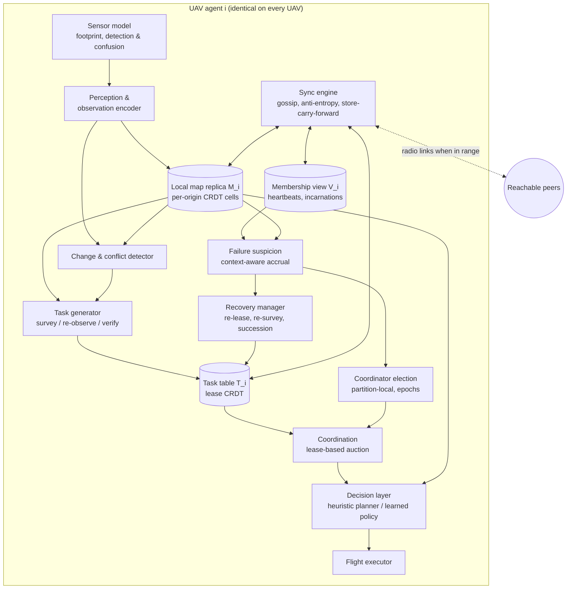
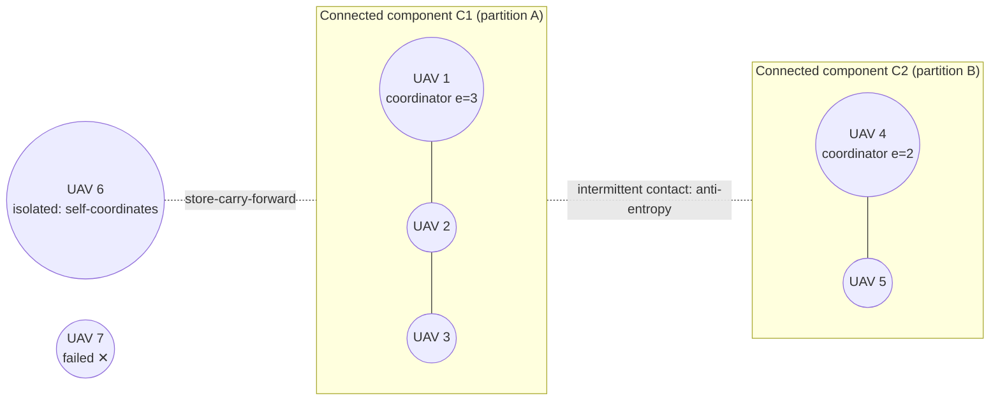
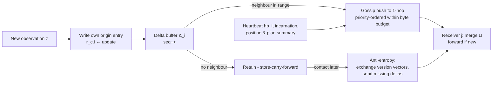

# Phase B — Research Design

**Title (unchanged):** AI-Driven Collaborative Environment Mapping, Resilient Coordination, and Self-Healing in Decentralized UAV Swarms under Intermittent Connectivity

**Date:** 2026-11-23 · **Builds on:** Phase A report and decisions D-1 (B, staged), D-2 (assume localization), D-3 (2D + 2.5D), D-9 (IEEE standard)

**Status:** design proposal for review. Nothing here is an experimental result.

**Labelling convention:** **[Lit]** = established in the literature (cited by Phase A IDs `Lxx` or by foundational work) · **[Design]** = proposed design decision · **[Assume]** = modelling assumption · **[Exp]** = expected outcome, to be tested.

---

## 1. Problem statement

Decentralized UAV swarms used for post-disaster search and rescue must build a shared picture of an unknown and changing environment while their communication links come and go. Existing work addresses the parts separately:
- collaborative mapping under limited communication [Lit: L01, L08, L12, L22];
- task reallocation and self-healing after UAV failures [Lit: L33, L35, L45, L47];
- conflict-free replication of shared knowledge outside UAV mapping [Lit: L18, L41].

Three practical problems therefore remain open:

1. **Divergence and reconciliation.** During a network partition, each group of UAVs updates its own copy of the map. After reconnection these copies must converge without double-counting evidence. At the same time, genuine environmental changes must override outdated observations.
2. **Silence is ambiguous.** A UAV that stops responding may have crashed, or it may simply be out of range [Lit: L37]. Treating every timeout as a crash produces duplicated work. Waiting too long leaves tasks and areas abandoned [Lit: L45 reports cascading failures from meeting-based detection].
3. **Failures also cost knowledge.** A failed UAV takes its unshared observations with it, and its assigned area becomes stale. Recovery must therefore restore *what the swarm knows*, not only *who does which task*.

## 2. Aim, research questions, objectives, hypotheses

**Aim.** Design, implement in simulation, and evaluate a decentralized framework in which autonomous UAV agents jointly maintain a convergent, change-aware environment model and preserve mission continuity under intermittent connectivity and UAV failures.

**Main research question (MRQ).** How can a decentralized UAV swarm maintain consistent shared environmental knowledge and mission continuity when communication is intermittent and UAVs may fail, without permanent dependence on a central controller?

| RQ | Supporting research question | Objective (measurable) | Hypothesis [Exp] | Primary metrics (§7) |
|---|---|---|---|---|
| RQ1 | How can per-UAV environment replicas be updated, propagated, and reconciled so that they converge after partitions while still reflecting environmental change? | O1: Design and implement a replicated semantic grid with delta synchronization. Show convergence and change tracking in Scenarios S2–S4, S6, S7, S12, S13. | H1: Compared with last-writer-wins and additive-fusion baselines, the proposed merge gives lower replica disagreement after reconnection and higher map accuracy under environmental change, at no more than equal communication bytes. | Replica disagreement *D(t)*, map accuracy, sync time, bytes |
| RQ2 | How can a UAV estimate whether a silent peer is disconnected or has failed, and how should that estimate drive recovery? | O2: Implement context-aware suspicion. Measure false-suspicion rate and detection latency against a fixed-timeout detector (S5, S8, S14). | H2: Conditioning suspicion on expected reachability lowers false failure declarations, and hence duplicate tasks, without a large increase in detection latency for real failures. | False-suspicion rate, detection latency, duplication rate |
| RQ3 | How can tasks, leadership, and *environmental knowledge* be recovered after single, multiple, and leader failures? | O3: Implement lease-based task recovery, partition-local coordinator succession, and map-aware re-survey. Measure recovery under S8–S10 and S14. | H3: Map-aware recovery raises mission completion and map completeness after failures compared with task-only recovery. | Task recovery time, leadership recovery time, mission completion, completeness |
| RQ4 | Does a learned exploration/task-selection policy that runs on the UAV's *local* map replica improve on the heuristic planner under intermittent connectivity? | O4 (gated, Stage 4b): Train a parameter-shared IPPO/MAPPO policy and compare it with the heuristic under matched conditions. | H4: The learned policy reaches at least the heuristic's coverage rate with less duplicated coverage. A negative result is reportable. | Coverage-time AUC, duplicated coverage |
| RQ5 | What are the overhead and scaling costs of the framework? | O5: Measure overhead for N ∈ {5, 10, 20} and different link-quality levels. | H5: Overhead per UAV grows sub-linearly in N because of delta-only anti-entropy. | Bytes/UAV/s, messages, CPU time per step |

Dynamic membership (joining and rejoining) is covered within RQ1 (state transfer) and RQ3 (rejoin reconciliation), in Scenarios S11 and S12.

## 3. Scope and assumptions

| ID | Assumption / scope rule | Justification | Threat to validity |
|---|---|---|---|
| A1 [Assume] | All UAVs share a global frame (GNSS-class). Position noise is ε ~ 𝒩(0, σ_p²I) with σ_p below the cell size. | D-2. C-SLAM is mature and out of scope [Lit: L02–L04, L22] | GNSS-denied settings are not covered |
| A2 [Assume] | Clocks are loosely synchronized (bounded skew δ_clk ≪ sync interval). | Follows from A1 (GNSS time). Timestamps are used for *recency weighting only*; correctness of the merge does not depend on them (§4.3) | Large clock skew would distort recency weighting |
| A3 [Assume] | Faults are crash-stop and omission only. Failed UAVs never send messages again; no Byzantine behaviour. | D-4 (default) | Malicious or sensor-faulty UAVs are not handled |
| A4 [Assume] | 2D grid plus a 2.5D height layer; cell size ≈ 10 m. | D-3 | Overhangs and indoor 3D structure are not represented |
| A5 [Assume] | Kinematic point-mass UAVs at a fixed altitude band; energy is linear in distance and hover time. | Flight dynamics are not part of the contribution | Energy figures are indicative only |
| A6 [Assume] | Abstract link layer: range R, distance-dependent loss, Gilbert–Elliott burst outages, scripted partitions, per-contact byte budget. No routing protocol. | [Lit: L38] routing is a separate field | Packet-level effects (MAC contention) are not modelled |
| A7 [Assume] | Mission: SAR area survey with semantic classes {free, obstacle, building, hazard, restricted, victim}. | D-6 (default) | Generalization to other missions is not tested |
| A8 [Assume] | Synthetic, seeded procedural worlds with exact ground truth, including scheduled environmental changes. | D-7 (default) | Realism of world statistics |

---

## 4. Proposed system architecture

### 4.1 Per-UAV agent architecture (component view)

Each UAV runs the same software stack, and no component requires a central node [Design].



### 4.2 High-level swarm architecture



Each connected component runs autonomously and has at most one *temporary* coordinator. Coordinators are an optimization: they speed up allocation and tie-breaking. Correctness never depends on them, because the map, the task table, and the membership view are all mergeable replicated state [Design].

### 4.3 Communication and information flow



### 4.4 Environmental update propagation (sequence)

```mermaid
sequenceDiagram
  participant A as UAV A
  participant B as UAV B (1 hop)
  participant C as UAV C (2 hops)
  A->>A: observe building at cells K; write r_{c,A}, v++, Δ_A seq=41
  A->>B: DELTA(origin=A, seq=41, cells K, priority=high)
  B->>B: merge (max-by-version per origin); VV_B[A]=41
  B->>C: forward DELTA(A,41) (new to C)
  C->>C: merge; VV_C[A]=41
  Note over A,C: duplicate receipt of seq 41 changes nothing (idempotent merge)
```

### 4.5 Failure detection and recovery (sequence)

```mermaid
sequenceDiagram
  participant B as UAV B (coordinator)
  participant C as UAV C
  participant D as UAV D (silent)
  Note over D: D stops sending heartbeats
  B->>B: φ_D rises; reachability ρ_BD high (D's plan keeps it in range)
  B->>C: PING-REQ(D) (indirect probe)
  C-->>B: no ack from D
  B->>B: P(failed | silence) ≥ θ_F → SUSPECTED-FAILED
  B->>B: revoke D's leases; mark D's sector cells "unverified since t_D"
  B->>B: generate re-survey tasks; run auction in component
  B->>C: LEASE(task k, owner=C, epoch=e)
  Note over B,C: if instead ρ_BD were low → UNREACHABLE: keep D's leases until expiry
```

### 4.6 Reconnection and map synchronization (sequence)

```mermaid
sequenceDiagram
  participant P as UAV P (partition A)
  participant Q as UAV Q (partition B)
  P->>Q: HELLO(VV_P, epoch/coordinator, membership digest)
  Q->>P: HELLO(VV_Q, epoch/coordinator, membership digest)
  P->>Q: missing deltas {Δ_o : seq > VV_Q[o]} (priority-ordered)
  Q->>P: missing deltas {Δ_o : seq > VV_P[o]}
  P->>P: merge map, tasks, membership; recompute fused cells
  Q->>Q: same → replicas equal once all deltas delivered
  P->>P: duplicate task leases? keep higher (epoch, bid, id); loser released
  P->>P: two coordinators? keep higher (epoch, score); other steps down
  P->>P: contested cells (recent disagreeing origins) → verification tasks
```

---

## 5. Mathematical model

### 5.1 Agents, time, connectivity

- UAV set **U** = {1,…,N}; discrete time t ∈ {0, Δt, 2Δt, …, T}.
- Alive indicator a_i(t) ∈ {0,1}. Under crash-stop (A3), once a_i becomes 0 it stays 0.
- Position p_i(t) ∈ ℝ²; energy E_i(t).
- Communication graph **G(t) = (U_a(t), E(t))**, where U_a(t) is the set of alive UAVs. An edge (i,j) ∈ E(t) exists iff

  ‖p_i − p_j‖ ≤ R ∧ g_ij(t) = GOOD ∧ ¬π_ij(t),

  where g_ij is a two-state Gilbert–Elliott link process and π_ij(t) is a scripted partition indicator.
- A message on an existing edge is delivered with probability q(d) = q₀ · (1 − (d/R)^κ) and consumes bytes from the per-contact budget B_ij per step.
- The connected components of G(t) are {𝒦_1(t), …}. **No UAV observes G(t) globally.** UAV i knows only its local view.

### 5.2 Environment and observations

- Grid cells c ∈ 𝒞, |𝒞| = W×H.
- Ground truth for each cell: occupancy x_c(t) ∈ {0,1}, semantic class s_c(t) ∈ 𝒮, height h_c(t).
- Ground truth can change at scheduled event times (e.g., a collapse, a new hazard, a cleared obstacle).
- A sensor footprint F(p_i) covers the cells within sensing radius r_s.
- For each c ∈ F(p_i), UAV i receives an observation z = (z^o, z^s, z^h):
  - occupancy: P(z^o = 1 | x_c = 1) = p_d and P(z^o = 1 | x_c = 0) = p_fa;
  - semantic class: drawn from a confusion matrix Π;
  - height: z^h = h_c + ε_h.

### 5.3 Replicated map: per-origin CRDT cells [Design]

UAV i holds replica M_i. For each cell c and each origin UAV o, the replica stores the entry

  **r_{c,o} = (v, τ, ℓ, σ, κ, η)**

| Symbol | Meaning |
|---|---|
| v ∈ ℕ | version, incremented **only by origin o** |
| τ | time of o's latest observation of c |
| ℓ | o's clamped log-odds occupancy evidence |
| σ | o's latest semantic label |
| κ ∈ [0,1] | confidence in σ |
| η | o's latest height estimate |

**Local update by origin i** after observing z at time t:

  ℓ ← clip(ℓ + log[P(z^o|x=1)/P(z^o|x=0)], −ℓ_max, ℓ_max)

and v ← v + 1, τ ← t, (σ, κ) ← (z^s, Π-based confidence), η ← z^h.

Clamping is a standard technique: it keeps the map responsive to change, because evidence cannot grow without bound.

**Merge.** Entries for the same (c, o) are ordered by v. Only o writes them, so equal versions imply identical content. The merge is defined as

  (M_i ⊔ M_j)[c][o] = argmax_v { M_i[c][o], M_j[c][o] }.

The merge is a per-key maximum, so it is commutative, associative, and idempotent. These are the join-semilattice properties of state-based CRDTs [Lit: L41; Shapiro et al. 2011]. Consequence: **any two replicas that have received the same set of entries are identical, regardless of delivery order or duplication.** This is the convergence property tested in H1. It follows from the cited CRDT theory and is not claimed as a new proof.

Re-receiving an entry is a no-op, so **evidence is never double-counted**. This is the failure mode of the additive-fusion baseline.

**Fused estimate (read path, computed locally).** With age Δ_o = t − τ_{c,o} and recency weight w(Δ) = exp(−λΔ):

  L_c^i(t) = Σ_o w(Δ_o) · ℓ_{c,o},  P̂_c^i(occ) = 1 / (1 + e^{−L_c^i}).

The semantic class is ŝ_c^i = argmax_s Σ_o w(Δ_o) κ_{c,o} 𝟙[σ_{c,o} = s], and the height is the w-weighted mean of η.

Recency weighting lets *new* observations of a changed cell dominate *old* ones from other origins, which handles environmental change [Lit: L09 for temporal reliability]. It only affects the read path, so convergence is unaffected.

**Staleness and conflict.**
- Cell age: age_c^i = t − max_o τ_{c,o}.
- A cell is **contested** if there exist origins o, o′ with Δ_o, Δ_o′ < T_conf, |ℓ_{c,o}|, |ℓ_{c,o′}| > θ_ℓ, and sign(ℓ_{c,o}) ≠ sign(ℓ_{c,o′}), or with conflicting high-confidence semantic labels.
- Contested cells generate **verification tasks** (§5.5). This is one of the couplings between mapping and coordination.

**Provenance** comes directly from the origin keys o and the timestamps τ.

### 5.4 Delta synchronization [Design]

- Each origin o batches its local updates into deltas Δ_o^k with sequence numbers k = 1, 2, … .
- UAV i keeps a version vector VV_i[o] = the highest contiguous sequence number received from o.
- **Gossip:** on creating or receiving a new delta, a UAV pushes it to its 1-hop neighbours within the byte budget.
- **Anti-entropy:** on contact, two UAVs exchange VV and send {Δ_o^k : k > VV_peer[o]}. This is the δ-state CRDT synchronization pattern [Lit: L18, L41; Almeida et al. 2018].
- Deltas wait in a priority queue, ordered by class (victim > hazard > building/obstacle > free) and then by recency. Under a binding budget, safety-relevant knowledge travels first.
- **Store-carry-forward is implicit**: a UAV carries other origins' deltas and passes them on at its next contact [Lit: L38, L48].

**Propagation delay** of feature f, first observed at t_f, is

  δ_f(β) = min{ t − t_f : fraction β of alive UAVs have P̂ consistent with f }.

### 5.5 Tasks and lease-based allocation [Design]

- The task set 𝒯_i(t) is generated *locally* from M_i and contains:
  - **survey** tasks for sectors with unknown cells;
  - **re-observe** tasks for cells with age > T_stale;
  - **verify** tasks for contested cells;
  - **re-survey** tasks for sectors owned by a UAV now suspected of failure.
- Task identifiers are deterministic functions of (type, sector, generation epoch), so separate partitions generate *the same* IDs for the same need.
- Task table T_i[k] = (owner, epoch e, lease expiry λ_k, bid b, status). Entries merge by lexicographic max over (status = done, e, b, −owner). This makes the task table a CRDT as well, and duplicates resolve deterministically on merge.
- Bid of UAV i for task k:

  b_ik = u_k · ρ_k − α · d(p_i, k)/v − β · max(0, E_reserve − (E_i − e_ik)),

  where u_k is the task value (information gain, class priority) and ρ_k is the deadline urgency.
- Within a component, the coordinator runs a sequential greedy auction (each round awards the highest b_ik; that UAV's bids are then re-evaluated). Without a coordinator, a UAV self-assigns the best task not leased by anyone in T_i.
- Leases are renewed through heartbeats while the owner is alive and reachable. A lease expires at λ_k if not renewed. Expiry, or a SUSPECTED-FAILED owner, returns the task to the pool [Lit: L35 task-local leases].

**Mission objective** over the horizon T:

  max J = w_1 · (victims confirmed / victims total) + w_2 · completeness(T) − w_3 · duplicated effort,

subject to energy reserve constraints and A1–A8.

### 5.6 Failure suspicion: disconnection vs failure [Design]

- Heartbeats are gossip-style counters hb_j [foundational: van Renesse et al. 1998]. Each heartbeat carries j's position, its current task, and a short plan summary.
- Let s_j = time since i last saw hb_j increase. **φ-accrual** [Hayashibara et al. 2004]:

  φ_j(s) = −log₁₀ P_later(s), where P_later is the tail of the estimated inter-arrival distribution.

- **Expected reachability.** ρ_ij(t) is the probability that j *should* be reachable now, computed from j's last reported position and plan, the link model, and i's own position. If j planned to fly out of range, a long silence is expected.
- Hypotheses for a silent peer: H_F (failed) and H_D (alive but disconnected). With per-step failure-rate prior μ, the prior for failure within the silent interval s is μs. Then

  P(H_F | silence s) = μs / ( μs + (1 − μs) · [(1 − ρ_ij) + ρ_ij · P_later(s)] ).

  The bracket is the probability of observing this silence if j is alive. It is high when j was expected to be out of range (ρ_ij small), so suspicion of failure stays low.
- **States** (with SWIM-style indirect probes through neighbours that can hear j):
  - **ALIVE**: hb_j heard recently.
  - **UNREACHABLE**: P(H_F) < θ_F. j's leases are kept until they expire; j is assumed to be still working.
  - **SUSPECTED-FAILED**: P(H_F) ≥ θ_F, or no ack to an indirect probe while ρ_ij is high. j's leases are revoked at once, and the knowledge-recovery tasks below are generated.
  - **REJOINED**: a fresh hb_j or a higher incarnation number refutes the suspicion. j's state is merged back and any duplicate leases are resolved by the §5.5 order.
- **Knowledge recovery.** For a SUSPECTED-FAILED UAV j with assigned sector Σ_j, the cells of Σ_j whose newest entry from j is older than j's last-heard time are marked *unverified*, and re-survey tasks are created. Observations that j made but never shared are unrecoverable. The framework bounds their effect; it cannot restore them. This limit is stated explicitly.

The **false-suspicion rate** is the fraction of SUSPECTED-FAILED declarations about UAVs that are in fact alive (known from ground truth).

### 5.7 Coordinator (leader) succession [Design]

- In component 𝒦, the coordinator is the UAV that maximizes score_i = (E_i/E_max, centrality in i's local view, −i) among members not suspected by the electing UAV.
- A UAV that suspects its coordinator (SUSPECTED-FAILED), or sees none, starts an election: it increments epoch e and broadcasts a CLAIM(e, score) within its component. The highest (e, score) received during a claim window wins.
- **Merge rule:** when two components meet, the coordinator with the higher (e, score) stays and the other steps down.
- Majority quorums are deliberately **not** used. Minority partitions must stay operational [foundational: CAP; Raft for contrast]. Preferring healthier nodes follows [Lit: L39].
- Leadership recovery time = time from coordinator failure to a unique coordinator being recognized by all members of the surviving component.

### 5.8 Membership and joining [Design]

- The membership view V_i is a map j → (incarnation, status, last heartbeat), merged by maximum incarnation, then by status severity.
- A **join** works as follows:
  1. The new UAV broadcasts JOIN.
  2. Any neighbour replies with full state (M, T, V).
  3. The new UAV adopts this state and starts heartbeats.
  4. Its first contact with each component triggers normal anti-entropy.
- The join cost (bytes, time to a usable map) is measured in S11.

### 5.9 Learned decision policy (Stage 4b, gated) [Design]

- **Observation:** an egocentric multi-channel crop of the UAV's *own replica* (P̂_occ, unknown mask, age, semantic one-hot, contested mask, teammates' last-known positions and lease targets), plus its own energy.
- **Action:** choose one of K candidate tasks or frontiers, produced by the task generator. The learned policy therefore never bypasses leases or safety rules.
- **Reward:** newly covered cells + w_v · new victim detections − w_d · duplicated coverage − w_e · energy.
- **Training:** parameter-shared IPPO/MAPPO [foundational: Yu et al. 2022], with randomized link quality, partitions, and failures. Execution is fully decentralized.
- **Go/no-go gate:** if, within the training budget, the policy does not reach the heuristic's coverage AUC on validation seeds, the result is reported as negative and the heuristic remains the default.

RL is **not** used for delivery, replication, or election. Those are engineered mechanisms.

---

## 6. Algorithms (pseudocode)

**Algorithm 1 — Agent main loop (UAV i, each step)**
```
1:  z ← SENSE(F(p_i))
2:  for each cell c in z: LOCALUPDATE(M_i[c][i], z_c, t); append to Δ_i
3:  if Δ_i nonempty: seal delta (i, seq_i += 1); push to outbox
4:  HEARTBEAT: hb_i += 1; enqueue (hb_i, inc_i, p_i, task_i, plan_i)
5:  N_i ← neighbours currently in range
6:  for j in N_i: SYNC(i, j)                       ▷ Alg. 2
7:  SUSPECT-UPDATE(V_i, t)                         ▷ Alg. 3
8:  RECOVER-AND-ELECT()                            ▷ Alg. 4
9:  𝒯_i ← GENERATE-TASKS(M_i, V_i)
10: task_i ← ALLOCATE(𝒯_i, T_i)                    ▷ Alg. 5
11: move toward task_i (heuristic planner or learned policy π_θ)
```

**Algorithm 2 — SYNC(i, j): gossip + anti-entropy within byte budget B_ij**
```
1: exchange (VV, coordinator epoch, membership digest)
2: D ← { Δ_o^k ∈ store_i : k > VV_j[o] }          ▷ includes carried deltas of other origins
3: sort D by (class priority desc, recency desc)
4: send prefix of D fitting B_ij; on delivery j does:
5:    for each entry r_{c,o} in Δ: M_j[c][o] ← argmax_v(M_j[c][o], r)   ▷ idempotent
6:    VV_j[o] ← highest contiguous seq; store Δ for forwarding
7: merge task tables T and membership views V by their lexicographic orders
```

**Algorithm 3 — SUSPECT-UPDATE (for each peer j ≠ i)**
```
1: if hb_j advanced since last step: status_j ← ALIVE; update inter-arrival stats; continue
2: s ← t − t_last(j); ρ ← REACHABILITY(p_i, last_pos_j, plan_j, link model)
3: pF ← μs / (μs + (1−μs)·((1−ρ) + ρ·P_later(s)))
4: if ρ high and status_j = ALIVE: send PING-REQ(j) to up to k neighbours
5: if pF ≥ θ_F or (ρ high and indirect probes failed): status_j ← SUSPECTED-FAILED
6: else if s > s_min: status_j ← UNREACHABLE
```

**Algorithm 4 — RECOVER-AND-ELECT**
```
1: for each j newly SUSPECTED-FAILED:
2:     release all leases with owner j in T_i
3:     mark cells of Σ_j with newest r_{c,j} older than t_last(j) as unverified
4:     add RE-SURVEY tasks for Σ_j
5: for each lease whose expiry passed without renewal: release it
6: if coordinator unknown or SUSPECTED-FAILED:
7:     e ← e + 1; broadcast CLAIM(e, score_i); wait claim window
8:     coordinator ← argmax over received (e, score, −id)
9: on meeting another coordinator: keep higher (e, score); the other steps down
```

**Algorithm 5 — ALLOCATE (lease-based)**
```
1: if i is coordinator:
2:     repeat: award (u, k) maximizing b_uk among unleased tasks and free members;
3:             write lease (k, owner=u, e, expiry = t + L) to T_i
4:     until no positive bid
5: else if no coordinator reachable:
6:     self-lease argmax_k b_ik among tasks unleased in T_i
7: renew own lease if still executing; return current task
```

The conflict and duplicate rules are deterministic, so two partitions that both leased task k converge to one owner on merge. The loser stops, and its partial coverage stays in the map, so the effort is not lost.

---

## 7. Evaluation metrics (definitions fixed now, results pending)

| Metric | Definition | RQ |
|---|---|---|
| Mission completion rate | Victims confirmed by T / total victims; also the fraction of runs reaching ≥ 95% coverage by T | MRQ, RQ3 |
| Map completeness | Fraction of non-restricted cells with ‖L_c^i‖ > θ_known, averaged over alive UAVs | RQ1, RQ3 |
| Map accuracy | Fraction of known cells whose (occupancy, class) match ground truth at time t | RQ1 |
| Replica disagreement D(t) | Mean over alive pairs (i,j) of the fraction of cells with differing (occ, class) estimates | RQ1 |
| Propagation delay δ_f(β) | §5.4, with β ∈ {0.5, 0.9, 1.0} of alive UAVs | RQ1 |
| Sync time after reconnection | Time from partition heal until D restricted to the merged pair falls below ε | RQ1 |
| Change-reflection delay | Time from a ground-truth change to ≥ 90% of alive UAVs reflecting it | RQ1 |
| False-suspicion rate / detection latency | §5.6 | RQ2 |
| Task recovery time | Time from failure to every task of the failed UAV being re-leased to an alive UAV | RQ3 |
| Leadership recovery time | §5.7 | RQ3 |
| Duplication rate | Duplicated task-time / total task-time, plus duplicated coverage | RQ2, RQ4 |
| Communication overhead | Bytes and messages per UAV per second, split into map / task / heartbeat | RQ5 |
| Delivery ratio (application level) | Delivered deltas / deltas generated with a reachable recipient | RQ1, RQ5 |

Energy use is reported but not used as a main claim (A5).

## 8. Baselines and ablations (definitions only; Phase C fixes the protocol)

| ID | Configuration | Purpose |
|---|---|---|
| B0 | Centralized oracle: global map, perfect comms, central auction | Upper bound |
| B1 | Decentralized, LWW map merge, fixed-timeout failure detection, no recovery | "No self-healing" baseline |
| B2 | Decentralized, additive log-odds fusion, fixed timeout + reassignment | Typical naive fusion |
| B3 | Proposed map + sync, but recovery is task-only (no knowledge recovery) | Isolates map-aware recovery (H3) |
| **P** | Full proposed framework (heuristic planner) | — |
| P+π | P with the learned policy (if the Stage 4b gate is passed) | H4 |
| Ablations | −anti-entropy (gossip only), −recency weighting, −reachability term (plain φ-accrual), −indirect probing, −coordinator (pure self-assignment), −priority queue | Contribution of each component |

---

## 9. Unresolved technical decisions (for your approval)

| ID | Decision | Provisional default |
|---|---|---|
| D-4 | Fault model | Crash-stop + omission (A3) |
| D-5 | Scale | N ∈ {5, 10, 20}; 2 km × 2 km; 10 m cells (200×200 grid); T = 30–40 min of simulated time; Δt = 1 s |
| D-6 | Mission | SAR survey with victims and hazards |
| D-7 | Worlds | Synthetic seeded worlds; 30 seeds per configuration (tentative, to be checked by power analysis in Phase C) |
| D-11 | Parameter values | R = 300 m, r_s = 50 m, ℓ_max = 3.5, λ, θ_F, lease length L, budget B_ij, set by a sensitivity sweep in Phase C rather than hand-picked |
| D-12 | Learned-policy budget | Fixed training budget (e.g., ≤ 24 GPU-hours or CPU-equivalent), decided after checking your hardware |
| D-13 | Target venue profile | IEEE two-column (D-9). Journal-style (≈ 12–14 pp. main paper) vs. a thesis-style long version that holds the ≈ 25-page literature review. I recommend **two artifacts**: the long MPhil manuscript and, later, a condensed IEEE paper |

## 10. Scope-control check

- **Pillar 1:** §5.3–5.4 and Alg. 1–2 cover the replica, delta sharing, change-aware fusion, conflict detection, and reconnection merge. ✅
- **Pillar 2:** §5.5 and Alg. 5 cover partition-local allocation with no permanent controller, and §5.1 models the network explicitly. ✅
- **Pillar 3:** §5.6–5.8 and Alg. 3–4 cover probabilistic suspicion, succession, redistribution, knowledge recovery, and join/rejoin. ✅
- AI is present: probabilistic evidence reasoning and inference over hypotheses in the core, plus a gated learned policy (D-1). RL is not used for networking or consistency guarantees. ✅
- No excluded technologies. The title and abstract are unchanged. ✅
